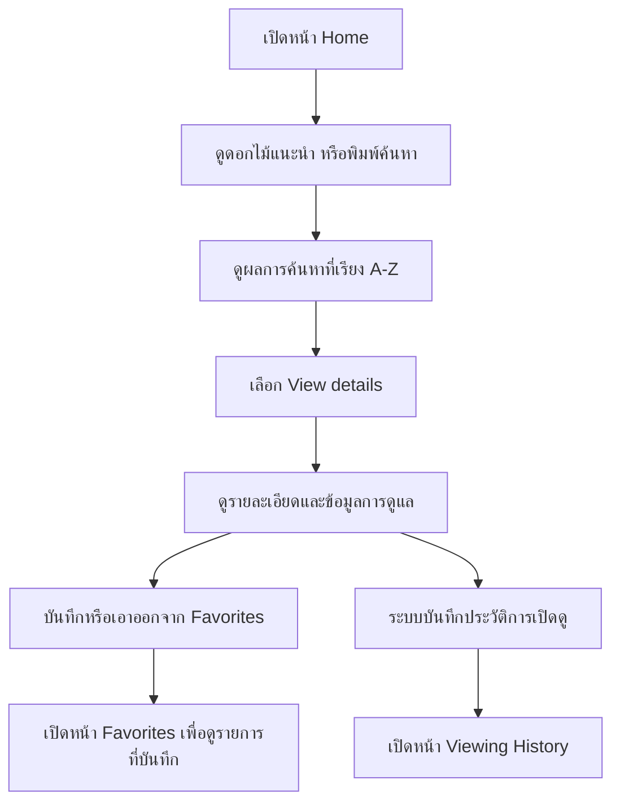
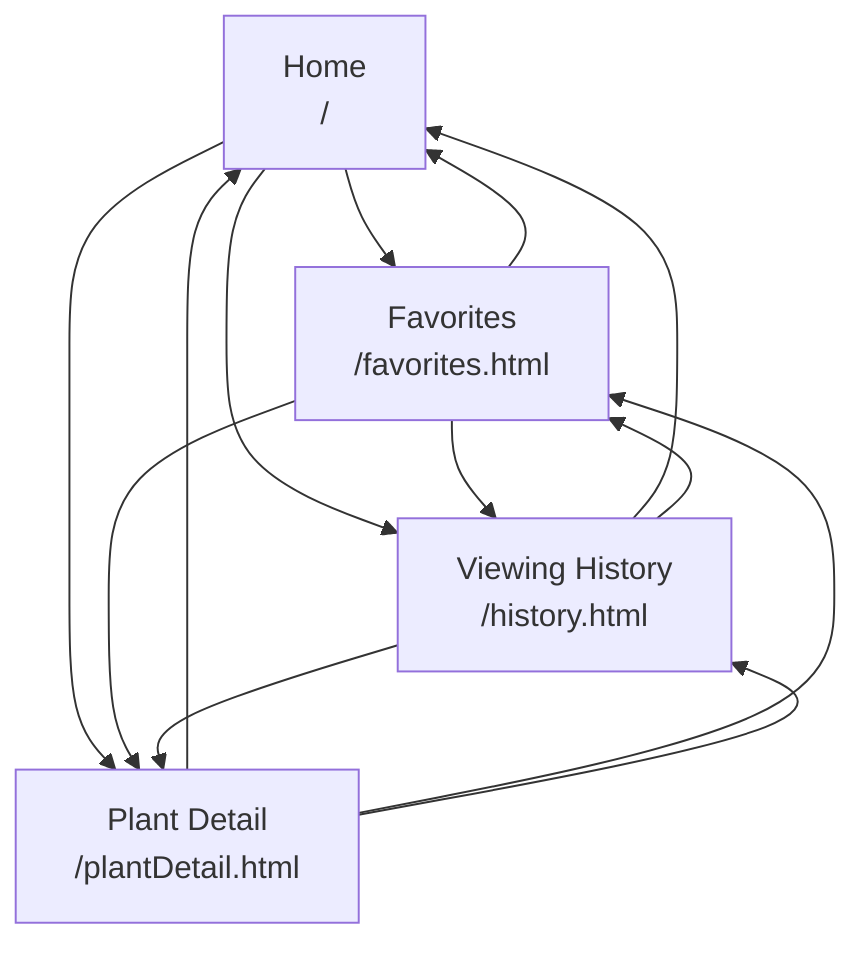
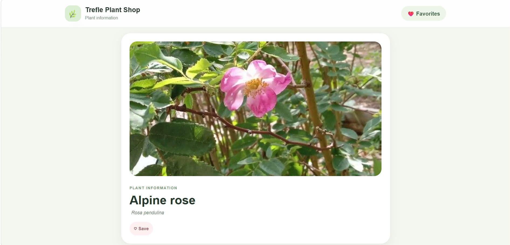
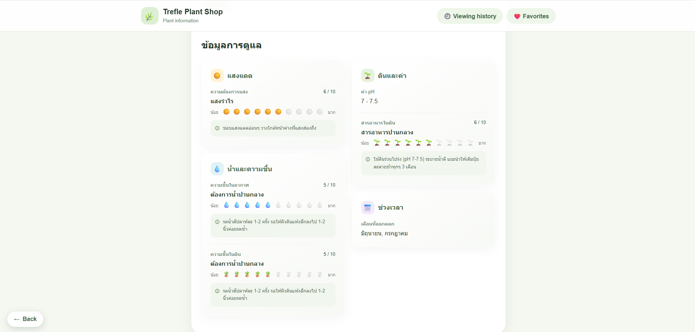
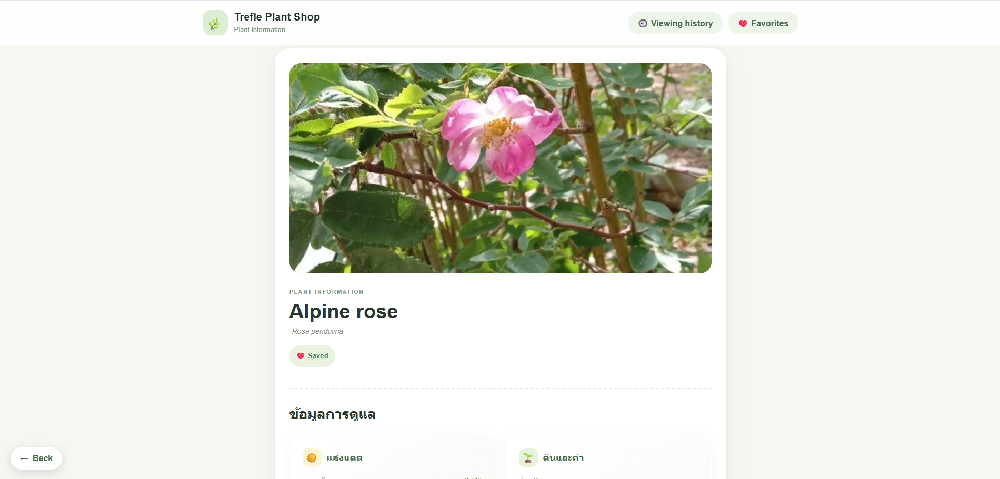

## 1. ฟีเจอร์หลัก

- ค้นหาต้นไม้จากชื่อผ่าน Trefle API
- แสดงดอกไม้แนะนำ โดยจัดอันดับจากความครบถ้วนของข้อมูลการดูแล
- ดูรายละเอียดต้นไม้และข้อมูลการดูแล เช่น แสง น้ำ ดิน และอุณหภูมิ ตามข้อมูลที่ API ส่งกลับมา
- เรียงผลการค้นหาตามชื่อสามัญ A–Z ด้วยอัลกอริทึม Insertion Sort
- เพิ่มและลบต้นไม้จากรายการโปรด
- ดูรายการโปรดที่บันทึกไว้
- ดูและล้างประวัติการเปิดรายละเอียดต้นไม้
- จดจำคำค้นและผลการค้นหาภายใน session ของแท็บเบราว์เซอร์
- แสดงสถานะ Loading, Empty และ Error ในส่วนที่เกี่ยวข้อง

## 2. เทคโนโลยีและสถาปัตยกรรม

| ส่วน | เทคโนโลยี / หน้าที่ |
|---|---|
| Frontend | React, Vite, React Router, HTML, CSS, JavaScript |
| Backend | Node.js และ Express |
| External API | Trefle API |
| Client storage | `sessionStorage` สำหรับสถานะการค้นหาและประวัติการดู |
| DSA / โครงสร้างข้อมูล | Insertion Sort และ Graph แบบ adjacency list; มี BFS เป็นฟังก์ชันตรวจสอบ Graph |

React ติดต่อ Express ผ่าน endpoint `/api/...` ส่วน Express เป็นตัวกลางติดต่อ Trefle API และอ่าน `TREFLE_TOKEN` จาก Environment Variable เพื่อไม่ให้ต้องใส่ token ไว้ในโค้ด Frontend

### การจัดเก็บข้อมูล

| ข้อมูล | ที่จัดเก็บตามโค้ดปัจจุบัน | หมายเหตุ |
|---|---|---|
| รายการโปรด | `localStorage` | เก็บต้นไม้ภายใต้ key `trefleshop_favorites`; เพิ่ม ลบ และคงข้อมูลเมื่อรีเฟรช |
| คำค้นและผลการค้นหา | `sessionStorage` | คงอยู่ภายใน session ของแท็บเบราว์เซอร์ |
| ประวัติการเปิดดู | `sessionStorage` | บันทึก slug ชื่อ และเวลาที่เปิดดู; ล้างได้จากหน้า Viewing History |
| รายการแนะนำ | หน่วยความจำ Express | Cache ภายในบริการเป็นเวลา 30 นาที |

> **ขอบเขต Favorites:** ข้อมูลอยู่ในเบราว์เซอร์ของผู้ใช้ ใช้ชื่อต้นฉบับโดยไม่ซิงก์ข้ามเครื่องหรือเบราว์เซอร์ และอาจหายเมื่อผู้ใช้ล้างข้อมูลเว็บไซต์

## 3. การติดตั้งและเริ่มใช้งาน

### สิ่งที่ต้องมี

- Node.js และ npm
- Trefle API token

### ขั้นตอนติดตั้ง

1. Clone repository และเปลี่ยนเข้าโฟลเดอร์โปรเจกต์

   ```bash
   git clone https://github.com/kumlaikaewnatcha-web/trefle-plant-shop.git
   cd trefle-plant-shop
   ```

2. เปลี่ยนไปยัง branch ที่ใช้พัฒนา

   ```bash
   git checkout feature/frontend-ux
   ```

3. ติดตั้ง dependencies

   ```bash
   npm install
   ```

4. สร้างไฟล์ `.env` ที่ root ของโปรเจกต์ และกำหนด token

   ```env
   TREFLE_TOKEN=ใส่_TREFLE_API_TOKEN_ของคุณ
   ```

5. เริ่ม Frontend และ Express พร้อมกันในโหมดพัฒนา

   ```bash
   npm run dev
   ```

   Vite จะให้บริการ Frontend และ proxy คำขอ `/api` ไปยัง Express ที่ `http://localhost:3000`

6. เปิด URL ที่ Vite แสดงใน Terminal (โดยทั่วไปคือ `http://localhost:5173`)

### คำสั่งที่ใช้

| คำสั่ง | หน้าที่ |
|---|---|
| `npm install` | ติดตั้ง dependencies |
| `npm run dev` | เริ่ม Vite และ Express พร้อมกัน |
| `npm run build` | build Frontend ไปยังโฟลเดอร์ `dist/` |
| `npm start` | เริ่ม Express server |
| `npm run preview` | เปิดดูผล build ด้วย Vite Preview |

> อย่า commit ไฟล์ `.env` หรือเปิดเผย `TREFLE_TOKEN` ในโค้ดสาธารณะ หาก deploy ให้กำหนด token ผ่าน Environment Variables ของแพลตฟอร์ม

## 4. API Endpoints

Express มี endpoint ดังนี้

| Method | Endpoint | หน้าที่ |
|---|---|---|
| `GET` | `/api/plants/search?q=rose` | ค้นหาต้นไม้จากคำค้น `q`; ถ้าไม่มีคำค้นจะตอบสถานะ `400` |
| `GET` | `/api/plants/recommendations` | ส่งรายการดอกไม้แนะนำ โดยรวบรวมผลจากหลายคำค้นและจัดอันดับความครบถ้วนของข้อมูลดูแล |
| `GET` | `/api/plants/:slug` | ดึงรายละเอียดต้นไม้จาก slug |
| `GET` | `/api/test` | ตรวจสอบว่า Express API ทำงานอยู่ |

### การทำงานของ Backend

- ตรวจสอบคำค้นก่อนเรียก Trefle API
- อ่าน API token จาก `process.env.TREFLE_TOKEN`
- กำหนด timeout ให้คำขอ Trefle API
- จัดการกรณีเชื่อมต่อ API ไม่สำเร็จ, HTTP error และ JSON ไม่ถูกต้อง
- รวมผลดอกไม้แนะนำจากหลายคำค้น และดึงรายละเอียดเพิ่มเติม
- Cache รายการแนะนำในหน่วยความจำ 30 นาที
- การตรวจสอบ `slug` ก่อนเพิ่มรายการโปรดทำใน Frontend ที่ `frontend/src/utils/plantUtils.js` ไม่ใช่ Backend
- มี Error Middleware สำหรับส่ง error กลับเป็น JSON

## 5. โครงสร้างโปรเจกต์

```text
.
├── api/
│   └── index.js                    # adapter สำหรับส่งออก Express app
├── backend/
│   ├── index.js                    # สร้าง Express app และ Error Middleware
│   ├── routes/
│   │   └── plantRoutes.js          # endpoints เกี่ยวกับต้นไม้
│   └── services/
│       └── trefleService.js        # ติดต่อ Trefle API และ cache คำแนะนำ
├── frontend/
│   ├── index.html
│   ├── public/
│   │   └── Cows_grazing_on_green_hills_1080p_20261024124512.mp4
│   ├── vite.config.js
│   └── src/
│       ├── Graph.js                # adjacency list และ BFS
│       ├── main.jsx                # React Router และจุดเริ่มต้นแอป
│       ├── components/
│       │   ├── DetailPanel.jsx
│       │   ├── Feedback.jsx
│       │   ├── HomeHero.jsx
│       │   ├── PageContainer.jsx
│       │   ├── PlantCard.jsx
│       │   ├── PlantCare.jsx
│       │   ├── PlantDetail.jsx
│       │   ├── PlantGrid.jsx
│       │   ├── PlantHistoryCard.jsx
│       │   ├── PlantSearchSection.jsx
│       │   ├── RecommendationsSection.jsx
│       │   ├── ResultSection.jsx
│       │   └── SiteLayout.jsx
│       ├── pages/
│       │   ├── HomePage.jsx
│       │   ├── PlantDetailPage.jsx
│       │   ├── FavoritesPage.jsx
│       │   └── HistoryPage.jsx
│       ├── services/
│       │   └── plantApi.js
│       ├── utils/
│       │   ├── plantCare.js
│       │   └── plantUtils.js
│       └── styles.css
├── .gitignore
├── package.json
├── package-lock.json
├── README.md
└── vercel.json
```

## 6. User Flow และการปรับปรุง UX

### User Flow ปัจจุบัน



### การปรับปรุง Flow ในเวอร์ชันนี้

1. **เริ่มค้นหาหรือเลือกจากรายการแนะนำได้ทันที:** หน้า Home แสดงดอกไม้แนะนำ และมีช่องค้นหาในส่วน Hero
2. **เข้าถึงรายละเอียดจากการ์ด:** ผู้ใช้กด `View details` จากการ์ดเพื่อเปิดหน้ารายละเอียดได้โดยตรง
3. **ดูข้อมูลในหน้าเดียว:** หน้ารายละเอียดแสดงชื่อ รูปภาพ สถานะ Favorites และข้อมูลการดูแลที่มีจาก API
4. **เก็บต้นไม้ที่สนใจ:** ผู้ใช้กด Save/Remove จากการ์ดหรือหน้ารายละเอียดได้
5. **ย้อนดูข้อมูลเดิม:** มีหน้า Favorites และ Viewing History ช่วยให้ผู้ใช้กลับไปยังต้นไม้ที่สนใจโดยไม่ต้องเริ่มค้นหาใหม่
6. **คงผลค้นหาใน session:** คำค้นและผลการค้นหาถูกเก็บใน `sessionStorage` เพื่อช่วยรักษาสถานะระหว่างการเปลี่ยนหน้า

## 7. Graph.js และการนำทางระหว่างหน้า

ไฟล์ `frontend/src/Graph.js` เก็บ Graph แบบ **adjacency list** โดย node คือหน้าเว็บ และ edge คือความสัมพันธ์/ลิงก์ที่พาผู้ใช้จากหน้าหนึ่งไปอีกหน้าหนึ่ง

### Node และเส้นเชื่อม

| Node | URL | หน้าที่เชื่อมไปได้ตาม `pageGraph` |
|---|---|---|
| `home` | `/` | history, favorites, detail |
| `favorites` | `/favorites.html` | home, history, detail |
| `history` | `/history.html` | home, favorites, detail |
| `detail` | `/plantDetail.html` | home, history, favorites |

แผนภาพการเชื่อมโยงหน้า (แสดงเฉพาะ edge ระหว่างคนละหน้า ซึ่งตรงกับข้อมูลใน `pageGraph`; แต่ละ node ไม่มี self-edge):



### การนำ Graph ไปใช้สร้างเมนู

1. `pageGraph` ระบุ node และ edge ของหน้าเว็บ
2. `pagePaths` จับคู่ node กับ URL ที่ React Router ใช้
3. `pageLabels` เก็บชื่อหน้าและ `menuLabel` สำหรับรายการที่ต้องแสดงในเมนู
4. `SiteHeader` ใช้ `useLocation()` ตรวจ URL ปัจจุบัน แล้วหา node ปัจจุบันจาก `pagePaths`
5. `SiteHeader` อ่าน edge ของ node ปัจจุบันจาก `pageGraph` และกรองปลายทางที่มี `menuLabel`
6. ใช้ `map()` สร้าง `<Link>` จากข้อมูล Graph และ `pagePaths` โดยไม่เขียนรายการเมนูซ้ำแบบตายตัวใน JSX
7. หน้า Plant Detail เข้าถึงได้จากลิงก์ `View details` บนการ์ดต้นไม้

### BFS ใน Graph.js

- `canReach(start, end, graph)` ใช้ Breadth-First Search (BFS) ตรวจว่ามีเส้นทางจาก node เริ่มต้นไปยัง node ปลายทางหรือไม่
- `checkGraph()` ตรวจ node ที่ไปจาก Home ไม่ถึง (`orphans`) และ node ที่กลับไป Home ไม่ได้ (`deadEnds`)
- Complexity ของ BFS คือ **O(V + E)** โดย V คือจำนวน node และ E คือจำนวน edge เนื่องจาก `canReach()` ใช้ตำแหน่ง `head` เพื่ออ่าน queue แบบคงที่ต่อ node แทนการ `shift()` สมาชิก Array

 > หมายเหตุ: จากโค้ดปัจจุบัน เมนูอ่านข้อมูลจาก `pageGraph` จริง ส่วน `canReach()` และ `checkGraph()` เป็นฟังก์ชันตรวจสอบ Graph ที่ประกาศไว้ แต่ยังไม่พบการเรียกใช้งานใน flow ของหน้าเว็บขณะตรวจสอบ ควรอธิบายแยกกันในคลิป ไม่ควรกล่าวว่า BFS เป็นตัวสร้างเมนู

## 8. DSA ที่ใช้กับข้อมูลจริง

| DSA | ไฟล์/จุดที่ใช้ | ข้อมูลที่ประมวลผลและผลต่อ UX | Complexity |
|---|---|---|---|
| Insertion Sort | `frontend/src/utils/plantUtils.js` เรียกใช้ใน `frontend/src/pages/HomePage.jsx` | เรียงผลการค้นหาต้นไม้ตาม `common_name` ก่อนแสดงผล ทำให้ผู้ใช้ไล่ดูชื่อ A–Z ได้ง่าย | Best case O(n), Average/Worst case O(n²); ฟังก์ชันคัดลอก array ก่อนเรียงจึงมีพื้นที่เพิ่ม O(n) |
| Browser Storage (ไม่จัดเป็น DSA ที่เขียนเอง) | `frontend/src/utils/plantUtils.js` | เก็บ Favorites ใน `localStorage` ภายใต้ key `trefleshop_favorites`; ใช้ `slug` ตรวจสอบรายการใน Array | การค้นหา slug ด้วย `.some()` และการกรองด้วย `.filter()` เป็น O(n) |
| Graph + BFS | `frontend/src/Graph.js` | Graph เก็บความสัมพันธ์ของหน้าและใช้ `pageGraph` สร้างเมนู; `canReach()` / `checkGraph()` เป็นฟังก์ชันตรวจสอบการเข้าถึง | BFS O(V + E); ฟังก์ชัน BFS ยังไม่ถูกเรียกใน flow หน้าเว็บปัจจุบัน |

### เหตุผลที่เลือกใช้

- **Insertion Sort:** เหมาะสำหรับอธิบายการเรียงข้อมูลในโปรเจกต์ และทำให้ผลค้นหามีลำดับ A–Z ก่อนแสดงแก่ผู้ใช้
- **Browser Storage:** ใช้ `localStorage` เก็บ Favorites และใช้ `sessionStorage` เก็บสถานะค้นหา/ประวัติการดู ส่วนนี้เป็นกลไกจัดเก็บข้อมูลของเบราว์เซอร์ ไม่ใช่การ implement Hash Table เอง
- **Graph:** แทนความสัมพันธ์การนำทางของแต่ละหน้าอย่างชัดเจน โดย `pageGraph` ถูกใช้สร้างเมนูจริง ส่วน BFS เป็นฟังก์ชันตรวจสอบเส้นทางที่มีอยู่ในโค้ด แต่ยังไม่ได้เชื่อมเข้ากับ flow ของผู้ใช้

## 9. ตารางส่วนร่วมของสมาชิก

| ชื่อ-สกุล | รหัสนักศึกษา | ชิ้นงานที่รับผิดชอบ (ไฟล์ / component / route / DSA) | ช่วงที่นำเสนอในคลิป |
|---|---|---|---|
| นางสาวธัญญ์นรี ทองอินทร์ | 681310012 | UX/UI,Graph | 2.50 น. |
| นางสาววรินทร มาสะและ | 681310022 | Frontend,Insertion Sort | 4.07 น. |
| นางสาวนัทชา กำไลแก้ว | 681310402 | Backend,API | 3.49 น. |

**สำคัญ:** ใบงานให้ระบุชิ้นงานที่ตรวจสอบได้แทนการแบ่งเป็นเปอร์เซ็นต์ และข้อมูลควรสอดคล้องกับ commit history ของ GitHub สมาชิกทุกคนควรตรวจสอบบัญชีผู้เขียน commit และประวัติการทำงานของตนเองก่อนส่ง

## 10. ตารางข้อแนะนำจากงานแรก → สิ่งที่แก้

> ข้อแนะนำในคอลัมน์แรกด้านล่างเป็นข้อความสรุปจาก README เดิม โปรดตรวจเทียบกับข้อเสนอแนะจริงที่ได้รับจากงานแรก และแก้ถ้อยคำให้ตรงกับหลักฐาน/คำแนะนำของอาจารย์

| ข้อแนะนำจากงานแรก | สิ่งที่แก้ในงานนี้ | หลักฐาน Before / After ที่ต้องแนบ |
|---|---|---|
| ต้องการข้อมูลรายละเอียดต้นไม้มากขึ้น | เพิ่มหน้า Plant Detail และส่วนข้อมูลการดูแลใน `frontend/src/components/PlantDetail.jsx` และ `PlantCare.jsx` | <br><br> |
| ต้องการปรับปรุงหน้าตาและการจัดวาง | ปรับ Hero, การ์ดต้นไม้, layout และ CSS ใน React | ภาพหน้าเว็บก่อนปรับและหลังปรับ |
| ต้องการให้การจัดการรายการโปรดสะดวกขึ้น | เพิ่ม/ลบรายการโปรดจากการ์ดและหน้ารายละเอียด พร้อมเชื่อม API | ภาพขั้นตอนการบันทึก/นำออก และผลที่แสดงต่อผู้ใช้ |
| ต้องการให้กลับมาดูต้นไม้ที่เคยเปิดได้ | เพิ่ม Viewing History และปุ่ม Clear History โดยใช้ `sessionStorage` | ภาพหน้าประวัติการดูและตัวอย่างหลังล้างประวัติ |

> ภาพจริงทั้ง Before และ After เป็นหลักฐานที่ใบงานกำหนด ตารางข้อความอย่างเดียวไม่ทดแทนภาพหน้าจอได้


## 11. Component Tree และการรับส่ง Props

โครงสร้างด้านล่างสรุปเส้นทางหลักของ Component จากไฟล์ `main.jsx` และการส่ง props ที่ตรวจพบในโค้ดจริง

```text
App (main.jsx)
└── BrowserRouter
    └── Routes
        ├── Route "/" 
        │   └── SiteLayout
        │       ├── SiteHeader
        │       ├── HomePage
        │       │   ├── PageContainer
        │       │   ├── HomeHero
        │       │   ├── RecommendationsSection
        │       │   │   └── PlantCard (หลายรายการ)
        │       │   └── PlantSearchSection
        │       │       └── SearchResults
        │       │           └── PlantCard (หลายรายการ)
        │       └── SiteFooter
        ├── Route "/favorites.html"
        │   └── SiteLayout
        │       └── FavoritesPage
        │           └── PlantCard (หลายรายการ)
        ├── Route "/history.html"
        │   └── SiteLayout
        │       └── HistoryPage
        │           └── PlantHistoryCard (หลายรายการ)
        └── Route "/plantDetail.html"
            └── SiteLayout
                └── PlantDetailPage
                    └── PlantDetail
                        └── PlantCare
```

### Props และ callback ที่สำคัญ

| Parent → Child | Props / Callback | ทิศทางและหน้าที่ |
|---|---|---|
| `HomePage` → `HomeHero` | `query`, `searchViewActive`, `onQueryChange`, `onSearch`, `onClearSearch` | ส่งค่าคำค้นและสถานะลงไป; `HomeHero` เรียก callback เพื่อแจ้งการพิมพ์ ค้นหา และล้างคำค้นกลับไปยัง `HomePage` |
| `HomePage` → `RecommendationsSection` | `plants`, `loading`, `error` | ส่งข้อมูลแนะนำและสถานะการโหลดให้ component ลูกแสดงผล |
| `HomePage` → `PlantSearchSection` | `plants`, `loading`, `error`, `selectedSlug`, `query`, `onOpenDetails` | ส่งผลค้นหาและสถานะลงไป; callback `onOpenDetails` แจ้ง slug ที่เลือกกลับไปให้ `HomePage` |
| `PlantSearchSection` → `SearchResults` → `PlantCard` | `plant`, `selected`, `onOpenDetails` | ส่งข้อมูลต้นไม้และสถานะการเลือกลงไป; `PlantCard` เรียก `onOpenDetails(slug)` เมื่อกดลิงก์รายละเอียด |
| `FavoritesPage` → `PlantCard` | `plant`, `onRemove` | ส่งข้อมูลต้นไม้และ callback ลบ; `PlantCard` เรียก `onRemove(slug)` เมื่อผู้ใช้กด Remove |
| `PlantDetailPage` → `PlantDetail` | `plant` | ส่งรายละเอียดต้นไม้ที่โหลดสำเร็จให้ component แสดงข้อมูล |
| `PlantDetail` → `PlantCare` | `plant` | ส่งข้อมูลต้นไม้ต่อให้ส่วนแสดงรายละเอียดการดูแล |

### เหตุผลในการวาง State

- `HomePage` เป็นเจ้าของ state การค้นหา เพราะ `HomeHero` ต้องแสดง/แก้คำค้น ขณะที่ `PlantSearchSection` ต้องแสดงผลค้นหาและสถานะเดียวกัน จึงยก state ไว้ที่ parent แล้วส่ง props ลง child
- `PlantDetailPage` เป็นเจ้าของ `plant`, `loading` และ `error` เพราะเป็นผู้เรียก API ตาม `slug` จาก URL แล้วส่งข้อมูลที่โหลดสำเร็จให้ `PlantDetail`
- `FavoritesPage` และ `HistoryPage` เก็บรายการที่แสดงในแต่ละหน้า เพราะเป็นข้อมูลเฉพาะหน้าที่ผู้ใช้แก้ไขจากหน้านั้น
- `PlantCard` และ `PlantDetail` เก็บสถานะปุ่ม Favorites ของตนเอง เพื่อให้การกด Save/Remove อัปเดต UI ของ component ที่เกี่ยวข้อง

> แผนภาพนี้เป็น Component Tree เชิงโครงสร้างของเส้นทางหลัก ไม่ได้แสดง HTML element ทุกตัวหรือ component ย่อยด้านการตกแต่งทั้งหมด

## 12. ตาราง useState

ตารางนี้สรุป state ที่พบใน React components ตามโค้ดปัจจุบัน โดย state ใช้เก็บค่าที่เปลี่ยนระหว่างการใช้งานและมีผลต่อการ render ส่วนค่าที่คำนวณจาก props/state อื่นไม่จำเป็นต้องเก็บซ้ำเป็น state

| ชื่อ state | เก็บข้อมูลอะไร | อยู่ใน component | เปลี่ยนค่าเมื่อใด / โดยใคร | ทำไมต้องเป็น state |
|---|---|---|---|---|
| `query` | คำค้นต้นไม้ | `HomePage` | ผู้ใช้พิมพ์ใน `HomeHero` ผ่าน `onQueryChange` | ให้ช่องค้นหาแสดงค่าล่าสุด |
| `searchViewActive` | เปิดโหมดแสดงผลค้นหาหรือไม่ | `HomePage` | เมื่อค้นหา ล้างคำค้น หรือกู้คืนคำค้นจาก session | ควบคุมการแสดงส่วนแนะนำและผลค้นหา |
| `plants` | ผลการค้นหาหรือ `null` ก่อนค้นหา | `HomePage` | เมื่อ API ตอบกลับ ค้นหาล้มเหลว หรือล้างการค้นหา | ใช้แสดงผลลัพธ์/สถานะว่าง |
| `selectedSlug` | slug ของต้นไม้ที่เลือก | `HomePage` | เมื่อเปิดรายละเอียดหรือเริ่มค้นหาใหม่ | แสดงว่าการ์ดใดถูกเลือก |
| `searchLoading` | กำลังค้นหาหรือไม่ | `HomePage` | ก่อนและหลังคำขอค้นหา | แสดง Loading ระหว่างรอ API |
| `searchError` | การค้นหาผิดพลาดหรือไม่ | `HomePage` | เมื่อคำขอล้มเหลวหรือเริ่มค้นหาใหม่ | แสดง Error ที่สัมพันธ์กับการค้นหา |
| `recommendations` | รายการต้นไม้แนะนำ | `HomePage` | หลัง API คำแนะนำตอบกลับสำเร็จ | แสดงรายการแนะนำที่โหลดจาก Express |
| `recommendationsLoading` | กำลังโหลดคำแนะนำหรือไม่ | `HomePage` | เริ่มต้นเป็น `true` และเปลี่ยนหลัง API เสร็จ | แสดง Loading ของส่วนแนะนำ |
| `recommendationsError` | คำขอคำแนะนำผิดพลาดหรือไม่ | `HomePage` | เมื่อ API คำแนะนำล้มเหลว | แสดง Error ของส่วนแนะนำ |
| `plants` | รายการโปรด | `FavoritesPage` | ตอนเริ่มต้นจาก `localStorage` และเมื่อลบรายการจากการ์ด | อัปเดตรายการที่เห็นโดยไม่โหลดทั้งหน้า |
| `plants` | ประวัติการเปิดดู | `HistoryPage` | เริ่มจาก `sessionStorage` และเปลี่ยนเมื่อกด Clear History | แสดงประวัติล่าสุดและผลหลังล้าง |
| `plant` | รายละเอียดต้นไม้ที่โหลดแล้ว | `PlantDetailPage` | เมื่อ slug เปลี่ยนและ API ตอบกลับ | แสดงข้อมูลต้นไม้ที่ตรงกับ URL |
| `loading` | กำลังโหลดรายละเอียดหรือไม่ | `PlantDetailPage` | ก่อนและหลังเรียก API รายละเอียด | แสดง Loading |
| `error` | โหลดรายละเอียดผิดพลาดหรือไม่ | `PlantDetailPage` | เมื่อไม่มี slug หรือ API ล้มเหลว | แสดง Error แทนรายละเอียดที่ไม่มี |
| `favorite` | สถานะรายการโปรดของต้นไม้ | `PlantCard` | หลังตรวจจาก `localStorage` และเมื่อเพิ่ม/ลบ | เปลี่ยนปุ่ม Save/Remove ตามสถานะที่เก็บไว้ |
| `saving` | กำลังเพิ่มหรือลบรายการโปรดหรือไม่ | `PlantCard` | ระหว่างการทำงานของปุ่มรายการโปรด | แสดงสถานะกำลังทำงานและป้องกันการกดซ้ำ |
| `imageFailed` | รูปภาพการ์ดโหลดไม่สำเร็จหรือไม่ | `PlantCard` | เมื่อรูปภาพเกิด `onError` | ซ่อนรูปที่โหลดไม่ได้ |
| `favoriteError` | ข้อผิดพลาดเมื่อตรวจสถานะรายการโปรด | `PlantCard` | เมื่อการตรวจสอบสถานะเกิด error | แสดง feedback และป้องกันการกดปุ่มในสถานะไม่แน่นอน |
| `favorite` | สถานะรายการโปรดในหน้ารายละเอียด | `PlantDetail` | หลังตรวจสถานะและเมื่อเพิ่ม/ลบ | อัปเดตปุ่มรายการโปรด |
| `saving` | กำลังเพิ่มหรือลบรายการโปรดหรือไม่ | `PlantDetail` | ระหว่างบันทึกลง `localStorage` | แสดงสถานะระหว่างบันทึกและป้องกันการกดซ้ำ |
| `favoriteError` | การเข้าถึง Favorites ใน Browser Storage ล้มเหลวหรือไม่ | `PlantDetail` | เมื่ออ่านหรือเขียน `localStorage` เกิด error | แสดงข้อความแจ้งผู้ใช้ |
| `imageFailed` | รูปภาพในหน้า Plant Detail โหลดไม่สำเร็จหรือไม่ | `PlantDetail` | เมื่อเกิด `onError` และถูกรีเซ็ตเมื่อ `plant.slug` เปลี่ยน | ซ่อนรูปที่โหลดไม่ได้และใช้สถานะใหม่สำหรับต้นไม้ถัดไป |

> `activeSearchId` ใน `HomePage` และ `recordedSlug` ใน `PlantDetailPage` เป็น `useRef` ไม่ใช่ state จึงไม่อยู่ในตาราง useState

## 13. ตาราง useEffect

| Component | Effect ทำอะไร | Dependency array | ทำงานตอนไหน |
|---|---|---|---|
| `HomePage` | ตั้งชื่อแท็บและเรียก API โหลดรายการแนะนำ พร้อม cleanup flag ป้องกัน setState หลังออกจากหน้า | `[]` | เมื่อ component mount; cleanup ตอน unmount |
| `FavoritesPage` | ตั้งชื่อแท็บและโหลดรายการโปรดจาก `localStorage` | `[]` | เมื่อ mount |
| `HistoryPage` | ตั้งชื่อแท็บของหน้าประวัติ | `[]` | เมื่อ mount |
| `PlantDetailPage` | ตั้งชื่อแท็บ โหลดรายละเอียดตาม slug และบันทึกประวัติเมื่อโหลดสำเร็จ | `[slug]` | เมื่อ mount และเมื่อ slug เปลี่ยน; cleanup ป้องกันอัปเดตจากคำขอเก่า |
| `PlantCard` | ตรวจสอบสถานะรายการโปรดของต้นไม้; ถ้ามี `onRemove` จะกำหนดสถานะเป็นรายการโปรดโดยไม่เรียกตรวจ API | `[plant.slug, Boolean(onRemove)]` | เมื่อ slug หรือโหมดการ์ดเปลี่ยน |
| `PlantDetail` | ตรวจสอบสถานะรายการโปรดของต้นไม้ที่แสดง พร้อม cleanup ป้องกันอัปเดต state หลังออกจากหน้าหรือคำขอเก่า | `[plant.slug]` | เมื่อ slug ของต้นไม้เปลี่ยน |
| `PlantDetail` | รีเซ็ตสถานะความผิดพลาดของรูปภาพเป็น `false` เมื่อแสดงต้นไม้คนละ slug | `[plant.slug]` | เมื่อ slug เปลี่ยน |

การกำหนด dependency ให้สอดคล้องกับค่าที่ effect ใช้ ช่วยให้โหลดข้อมูลเมื่อจำเป็น ส่วน cleanup flag ใน effect ที่เรียก API ช่วยป้องกันการอัปเดต state หลัง component ถูกถอดออกจากหน้า หรือเมื่อผลลัพธ์จากคำขอเก่ากลับมาทีหลัง

## 14. สถานะ UX และการจัดการข้อผิดพลาด

| สถานะ | ตัวอย่างในโปรเจกต์ | การตอบสนองต่อผู้ใช้ |
|---|---|---|
| Loading | Search และ Recommendations ในหน้า Home; Plant Detail | แสดง `LoadingState` ระหว่างรอข้อมูล |
| Empty | Search ที่ยังไม่เริ่ม/ไม่พบผล, Favorites ว่าง, History ว่าง, Recommendations ว่าง | แสดง `EmptyState` พร้อมข้อความแนะนำ |
| Error | Search, Recommendations และ Plant Detail | แสดง `ErrorState`; Favorites/History อ่าน Storage ผ่าน utility ที่จัดการ exception และคืนค่าเริ่มต้น แต่ไม่ได้มี Loading/Error UI แบบเดียวกับหน้า API |
| Success / มีข้อมูล | API ส่งข้อมูลกลับสำเร็จ หรือมีข้อมูลใน Browser Storage | แสดงการ์ดต้นไม้ รายละเอียด หรือรายการที่บันทึกไว้ |
