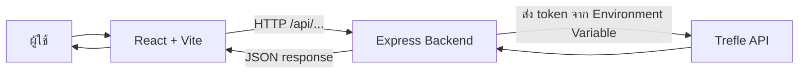
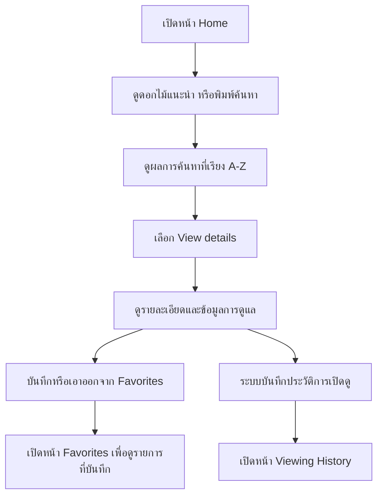
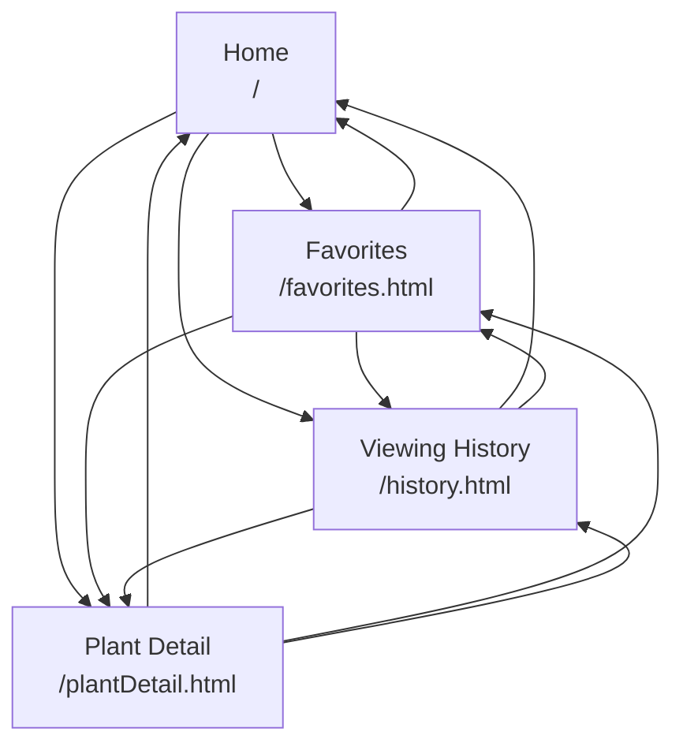

## 1. ฟีเจอร์หลัก

- ค้นหาต้นไม้จากชื่อผ่าน Trefle API
- แสดงดอกไม้แนะนำ โดยจัดอันดับจากความครบถ้วนของข้อมูลการดูแล
- ดูรายละเอียดต้นไม้และข้อมูลการดูแล เช่น แสง น้ำ ดิน และอุณหภูมิ ตามข้อมูลที่ API ส่งกลับมา
- เรียงผลการค้นหาตามชื่อสามัญ A–Z ด้วยอัลกอริทึม Insertion Sort
- เพิ่มและลบต้นไม้จากรายการโปรด
- ดูรายการโปรดที่บันทึกไว้
- ดูและล้างประวัติการเปิดรายละเอียดต้นไม้
- จดจำคำค้นและผลการค้นหาภายใน session ของแท็บเบราว์เซอร์
- แสดงสถานะ Loading, Empty และ Error ในส่วนที่เกี่ยวข้อง

## 2. เทคโนโลยีและสถาปัตยกรรม

| ส่วน | เทคโนโลยี / หน้าที่ |
|---|---|
| Frontend | React, Vite, React Router, HTML, CSS, JavaScript |
| Backend | Node.js และ Express |
| External API | Trefle API |
| Client storage | `localStorage` สำหรับรายการโปรด และ `sessionStorage` สำหรับสถานะการค้นหา/ประวัติการดู |
| DSA | Insertion Sort, Hash Table (`Map`) และ Graph แบบ adjacency list |

### ภาพรวมการทำงาน



React ติดต่อ Express ผ่าน endpoint `/api/...` ส่วน Express เป็นตัวกลางติดต่อ Trefle API และอ่าน `TREFLE_TOKEN` จาก Environment Variable เพื่อไม่ให้ต้องใส่ token ไว้ในโค้ด Frontend

### การจัดเก็บข้อมูล

| ข้อมูล | ที่จัดเก็บตามโค้ดปัจจุบัน | หมายเหตุ |
|---|---|---|
| รายการโปรดในเบราว์เซอร์ | `localStorage` | เป็นแหล่งข้อมูลที่ Frontend ใช้ตรวจสถานะรายการโปรดและมีข้อมูลสำรองเมื่อเรียก API ไม่สำเร็จ |
| รายการโปรดฝั่ง Express | `Map` ในหน่วยความจำ | Frontend พยายามส่งการเพิ่ม/ลบไปยัง Express; ข้อมูลฝั่งเซิร์ฟเวอร์หายเมื่อเซิร์ฟเวอร์เริ่มใหม่ |
| คำค้นและผลการค้นหา | `sessionStorage` | คงอยู่ภายใน session ของแท็บเบราว์เซอร์ |
| ประวัติการเปิดดู | `sessionStorage` | บันทึก slug ชื่อ และเวลาที่เปิดดู; ล้างได้จากหน้า Viewing History |
| รายการแนะนำ | หน่วยความจำ Express | Cache ภายในบริการเป็นเวลา 30 นาที |

> **หมายเหตุสำคัญเกี่ยวกับ Favorites:** โค้ดปัจจุบันใช้ทั้ง `localStorage` ฝั่ง Frontend และ `Map` ฝั่ง Express โดย `checkFavorite()` ตรวจจาก `localStorage` และ `addFavorite()` / `removeFavorite()` อัปเดต `localStorage` ก่อนแล้วจึงพยายามเรียก Express ทั้งนี้คำขอ API ในสองฟังก์ชันดังกล่าวมีการดักข้อผิดพลาดไว้ จึงยังไม่ควรถือว่าการบันทึกฝั่ง Express สำเร็จทุกครั้ง ควรปรับการจัดการ error ในโค้ดก่อนใช้เป็นหลักฐานว่า Backend บันทึกสำเร็จ

## 3. การติดตั้งและเริ่มใช้งาน

### สิ่งที่ต้องมี

- Node.js และ npm
- Trefle API token

### ขั้นตอนติดตั้ง

1. Clone repository และเปลี่ยนเข้าโฟลเดอร์โปรเจกต์

   ```bash
   git clone https://github.com/kumlaikaewnatcha-web/trefle-plant-shop.git
   cd trefle-plant-shop
   ```

2. เปลี่ยนไปยัง branch ที่ใช้พัฒนา

   ```bash
   git checkout feature/frontend-ux
   ```

3. ติดตั้ง dependencies

   ```bash
   npm install
   ```

4. สร้างไฟล์ `.env` ที่ root ของโปรเจกต์ และกำหนด token

   ```env
   TREFLE_TOKEN=ใส่_TREFLE_API_TOKEN_ของคุณ
   ```

5. เริ่ม Frontend และ Express พร้อมกันในโหมดพัฒนา

   ```bash
   npm run dev
   ```

   Vite จะให้บริการ Frontend และ proxy คำขอ `/api` ไปยัง Express ที่ `http://localhost:3000`

6. เปิด URL ที่ Vite แสดงใน Terminal (โดยทั่วไปคือ `http://localhost:5173`)

### คำสั่งที่ใช้

| คำสั่ง | หน้าที่ |
|---|---|
| `npm install` | ติดตั้ง dependencies |
| `npm run dev` | เริ่ม Vite และ Express พร้อมกัน |
| `npm run build` | build Frontend ไปยังโฟลเดอร์ `dist/` |
| `npm start` | เริ่ม Express server |
| `npm run preview` | เปิดดูผล build ด้วย Vite Preview |

> อย่า commit ไฟล์ `.env` หรือเปิดเผย `TREFLE_TOKEN` ในโค้ดสาธารณะ หาก deploy ให้กำหนด token ผ่าน Environment Variables ของแพลตฟอร์ม

## 4. API Endpoints

Express มี endpoint ดังนี้

| Method | Endpoint | หน้าที่ |
|---|---|---|
| `GET` | `/api/plants/search?q=rose` | ค้นหาต้นไม้จากคำค้น `q`; ถ้าไม่มีคำค้นจะตอบสถานะ `400` |
| `GET` | `/api/plants/recommendations` | ส่งรายการดอกไม้แนะนำ โดยรวบรวมผลจากหลายคำค้นและจัดอันดับความครบถ้วนของข้อมูลดูแล |
| `GET` | `/api/plants/:slug` | ดึงรายละเอียดต้นไม้จาก slug |
| `GET` | `/api/favorites` | ดึงรายการโปรดที่อยู่ใน `Map` ฝั่ง Express |
| `POST` | `/api/favorites` | เพิ่มต้นไม้โปรด โดยตรวจสอบว่า `slug` เป็นข้อความที่ไม่ว่าง |
| `GET` | `/api/favorites/:slug` | ตรวจสอบว่ามีต้นไม้ slug นี้ในรายการโปรดฝั่ง Express หรือไม่ |
| `DELETE` | `/api/favorites/:slug` | ลบต้นไม้ออกจากรายการโปรดฝั่ง Express |
| `GET` | `/api/test` | ตรวจสอบว่า Express API ทำงานอยู่ |

ตัวอย่างการเพิ่มรายการโปรดด้วย JSON:

```http
POST /api/favorites
Content-Type: application/json

{
  "slug": "ตัวอย่าง-slug",
  "common_name": "ตัวอย่างต้นไม้"
}
```

### การทำงานของ Backend

- ตรวจสอบคำค้นก่อนเรียก Trefle API
- อ่าน API token จาก `process.env.TREFLE_TOKEN`
- กำหนด timeout ให้คำขอ Trefle API
- จัดการกรณีเชื่อมต่อ API ไม่สำเร็จ, HTTP error และ JSON ไม่ถูกต้อง
- รวมผลดอกไม้แนะนำจากหลายคำค้น และดึงรายละเอียดเพิ่มเติม
- Cache รายการแนะนำในหน่วยความจำ 30 นาที
- ตรวจสอบข้อมูล `slug` ก่อนเพิ่มรายการโปรด
- มี Error Middleware สำหรับส่ง error กลับเป็น JSON

## 5. โครงสร้างโปรเจกต์

```text
.
├── api/
│   └── index.js                    # adapter สำหรับส่งออก Express app
├── backend/
│   ├── index.js                    # สร้าง Express app และ Error Middleware
│   ├── server.js                   # ส่งออกแอปหลัก
│   ├── routes/
│   │   ├── plantRoutes.js          # endpoints เกี่ยวกับต้นไม้
│   │   └── favoriteRoutes.js       # endpoints เกี่ยวกับรายการโปรด
│   └── services/
│       ├── trefleService.js        # ติดต่อ Trefle API และ cache คำแนะนำ
│       └── favoriteService.js      # จัดเก็บ Favorites ด้วย Map
├── frontend/
│   ├── index.html
│   ├── public/
│   │   └── Cows_grazing_on_green_hills_1080p_20261024124512.mp4
│   ├── vite.config.js
│   └── src/
│       ├── Graph.js                # adjacency list และ BFS
│       ├── main.jsx                # React Router และจุดเริ่มต้นแอป
│       ├── components/
│       │   ├── DetailPanel.jsx
│       │   ├── Feedback.jsx
│       │   ├── HomeHero.jsx
│       │   ├── PageContainer.jsx
│       │   ├── PlantCard.jsx
│       │   ├── PlantCare.jsx
│       │   ├── PlantDetail.jsx
│       │   ├── PlantGrid.jsx
│       │   ├── PlantHistoryCard.jsx
│       │   ├── PlantSearchSection.jsx
│       │   ├── RecommendationsSection.jsx
│       │   ├── ResultSection.jsx
│       │   └── SiteLayout.jsx
│       ├── pages/
│       │   ├── HomePage.jsx
│       │   ├── PlantDetailPage.jsx
│       │   ├── FavoritesPage.jsx
│       │   └── HistoryPage.jsx
│       ├── services/
│       │   └── plantApi.js
│       ├── utils/
│       │   ├── plantCare.js
│       │   └── plantUtils.js
│       └── styles.css
├── .gitignore
├── package.json
├── package-lock.json
├── README.md
└── vercel.json
```

## 6. User Flow และการปรับปรุง UX

### User Flow ปัจจุบัน



### การปรับปรุง Flow ในเวอร์ชันนี้

1. **เริ่มค้นหาหรือเลือกจากรายการแนะนำได้ทันที:** หน้า Home แสดงดอกไม้แนะนำ และมีช่องค้นหาในส่วน Hero
2. **เข้าถึงรายละเอียดจากการ์ด:** ผู้ใช้กด `View details` จากการ์ดเพื่อเปิดหน้ารายละเอียดได้โดยตรง
3. **ดูข้อมูลในหน้าเดียว:** หน้ารายละเอียดแสดงชื่อ รูปภาพ สถานะ Favorites และข้อมูลการดูแลที่มีจาก API
4. **เก็บต้นไม้ที่สนใจ:** ผู้ใช้กด Save/Remove จากการ์ดหรือหน้ารายละเอียดได้
5. **ย้อนดูข้อมูลเดิม:** มีหน้า Favorites และ Viewing History ช่วยให้ผู้ใช้กลับไปยังต้นไม้ที่สนใจโดยไม่ต้องเริ่มค้นหาใหม่
6. **คงผลค้นหาใน session:** คำค้นและผลการค้นหาถูกเก็บใน `sessionStorage` เพื่อช่วยรักษาสถานะระหว่างการเปลี่ยนหน้า

### เปรียบเทียบ Before → After

> **ต้องเติมข้อมูลและภาพจากงานแรกจริงก่อนส่งงาน** เนื่องจากยังไม่มีภาพหน้าจอเวอร์ชันแรกแนบมาในคำขอนี้ ไม่ควรระบุว่าเวอร์ชันแรกไม่มีฟีเจอร์ใด หากระบบเดิมมีฟีเจอร์นั้นอยู่แล้ว

| ประเด็น | Before: งาน API ครั้งแรก | After: เวอร์ชันปัจจุบัน |
|---|---|---|
| การเริ่มค้นหา/เลือกต้นไม้ | [เติมขั้นตอนตามระบบเดิมและแนบภาพจริง] | มีรายการแนะนำบน Home และช่องค้นหาในหน้าเดียว |
| การดูรายละเอียด | [เติมพฤติกรรมของเวอร์ชันแรก] | เปิดหน้า Plant Detail จากปุ่ม `View details` บนการ์ด |
| ข้อมูลการดูแล | [เติมข้อมูลที่เวอร์ชันแรกแสดงจริง] | แสดงข้อมูลการดูแลที่แปลงจากข้อมูลต้นไม้ที่ API ส่งกลับ |
| การกลับมาดูต้นไม้ที่สนใจ | [เติมวิธีเดิม] | มี Favorites และ Viewing History |
| การรักษาผลค้นหา | [เติมพฤติกรรมเดิม] | เก็บคำค้นและผลการค้นหาใน `sessionStorage` |

### ภาพหลักฐาน Before / After ที่ต้องเพิ่ม

สร้างโฟลเดอร์ `docs/images/` ใน repository แล้วเพิ่มภาพจริงตามรายการนี้ จากนั้นจึงแทรก Markdown image link ในตารางหรือใต้หัวข้อนี้

| ภาพที่ต้องใช้ | ชื่อไฟล์ที่แนะนำ |
|---|---|
| หน้า Home ก่อนปรับปรุง | `docs/images/before-home.png` |
| หน้า Home หลังปรับปรุง | `docs/images/after-home.png` |
| หน้ารายละเอียดก่อนปรับปรุง | `docs/images/before-detail.png` |
| หน้ารายละเอียดหลังปรับปรุง | `docs/images/after-detail.png` |
| หน้า Favorites หรือ Viewing History | `docs/images/after-favorites-history.png` |

ตัวอย่าง Markdown สำหรับแทรกภาพหลังเพิ่มไฟล์แล้ว:

```md

```

## 7. Graph.js และการนำทางระหว่างหน้า

ไฟล์ `frontend/src/Graph.js` เก็บ Graph แบบ **adjacency list** โดย node คือหน้าเว็บ และ edge คือความสัมพันธ์/ลิงก์ที่พาผู้ใช้จากหน้าหนึ่งไปอีกหน้าหนึ่ง

### Node และเส้นเชื่อม

| Node | URL | หน้าที่เชื่อมไปได้ตาม `pageGraph` |
|---|---|---|
| `home` | `/` | home, history, favorites, detail |
| `favorites` | `/favorites.html` | home, history, favorites, detail |
| `history` | `/history.html` | home, favorites, history, detail |
| `detail` | `/plantDetail.html` | home, history, favorites, detail |

แผนภาพการเชื่อมโยงหน้า (แสดง edge ระหว่างคนละหน้าเพื่อให้อ่านง่าย โดยในข้อมูล Graph มี self-edge ของแต่ละ node ด้วย):



### การนำ Graph ไปใช้สร้างเมนู

1. `pageGraph` ระบุ node และ edge ของหน้าเว็บ
2. `pagePaths` จับคู่ node กับ URL ที่ React Router ใช้
3. `pageLabels` เก็บชื่อหน้าและ `menuLabel` สำหรับรายการที่ต้องแสดงในเมนู
4. `SiteHeader` ใช้ `useLocation()` ตรวจ URL ปัจจุบัน แล้วหา node ปัจจุบันจาก `pagePaths`
5. `SiteHeader` อ่าน edge ของ node ปัจจุบันจาก `pageGraph` และกรองปลายทางที่มี `menuLabel`
6. ใช้ `map()` สร้าง `<Link>` จากข้อมูล Graph และ `pagePaths` โดยไม่เขียนรายการเมนูซ้ำแบบตายตัวใน JSX
7. หน้า Plant Detail เข้าถึงได้จากลิงก์ `View details` บนการ์ดต้นไม้

### BFS ใน Graph.js

- `canReach(start, end, graph)` ใช้ Breadth-First Search (BFS) ตรวจว่ามีเส้นทางจาก node เริ่มต้นไปยัง node ปลายทางหรือไม่
- `checkGraph()` ตรวจ node ที่ไปจาก Home ไม่ถึง (`orphans`) และ node ที่กลับไป Home ไม่ได้ (`deadEnds`)
- Complexity ของ BFS คือ **O(V + E)** โดย V คือจำนวน node และ E คือจำนวน edge

> หมายเหตุ: จากโค้ดปัจจุบัน เมนูอ่านข้อมูลจาก `pageGraph` จริง ส่วน `canReach()` และ `checkGraph()` เป็นฟังก์ชันตรวจสอบ Graph ที่ประกาศไว้ แต่ยังไม่พบการเรียกใช้งานใน flow ของหน้าเว็บขณะตรวจสอบ ควรอธิบายแยกกันในคลิป ไม่ควรกล่าวว่า BFS เป็นตัวสร้างเมนู

## 8. DSA ที่ใช้กับข้อมูลจริง

| DSA | ไฟล์/จุดที่ใช้ | ข้อมูลที่ประมวลผลและผลต่อ UX | Complexity |
|---|---|---|---|
| Insertion Sort | `frontend/src/utils/plantUtils.js` เรียกใช้ใน `frontend/src/pages/HomePage.jsx` | เรียงผลการค้นหาต้นไม้ตาม `common_name` ก่อนแสดงผล ทำให้ผู้ใช้ไล่ดูชื่อ A–Z ได้ง่าย | Best case O(n), Average/Worst case O(n²); ฟังก์ชันคัดลอก array ก่อนเรียงจึงมีพื้นที่เพิ่ม O(n) |
| Hash Table ผ่าน `Map` | `backend/services/favoriteService.js` | ใช้ `slug` เป็น key สำหรับเพิ่ม ตรวจสอบ และลบรายการโปรด ลดการค้นหารายการด้วยการวน array | `set()`, `has()`, `delete()` เฉลี่ย O(1); พื้นที่ O(n) |
| Graph + BFS | `frontend/src/Graph.js` | Graph เก็บความสัมพันธ์ของหน้า; BFS ตรวจสอบการเข้าถึง node ใน Graph | BFS O(V + E) |

### เหตุผลที่เลือกใช้

- **Insertion Sort:** เหมาะสำหรับอธิบายการเรียงข้อมูลในโปรเจกต์ และทำให้ผลค้นหามีลำดับ A–Z ก่อนแสดงแก่ผู้ใช้
- **Hash Table (`Map`):** ใช้ slug ซึ่งเป็นตัวระบุของต้นไม้เป็น key ทำให้เพิ่ม ตรวจสอบ และลบรายการโปรดได้โดยตรง
- **Graph:** แทนความสัมพันธ์การนำทางของแต่ละหน้าอย่างชัดเจน และสามารถตรวจสอบเส้นทางด้วย BFS ได้

## 9. ตารางส่วนร่วมของสมาชิก

> ตารางด้านล่างยึดรายชื่อและบทบาทตาม README เดิม ต้องให้สมาชิกตรวจสอบและแก้ไขให้ตรงกับงานที่ทำจริง รวมถึงชื่อไฟล์/Component/Route/DSA และช่วงเวลาที่นำเสนอ ก่อนส่งงาน

| ชื่อ-สกุล | รหัสนักศึกษา | ชิ้นงานที่รับผิดชอบ (ไฟล์ / component / route / DSA) | ช่วงที่นำเสนอในคลิป |
|---|---|---|---|
| นางสาวธัญญ์นรี ทองอินทร์ | 681310012 | UX/UI และส่วน Frontend — ระบุชื่อไฟล์/Component ที่รับผิดชอบจริงเพิ่มเติม | เติมเวลาจริงหลังตัดต่อคลิป |
| นางสาววรินทร มาสาและ | 681310022 | DSA — ระบุอัลกอริทึมและไฟล์ที่รับผิดชอบจริงเพิ่มเติม | เติมเวลาจริงหลังตัดต่อคลิป |
| นางสาวนัทชา กำไลแก้ว | 681310402 | Backend/API — ระบุ Route/Service ที่รับผิดชอบจริงเพิ่มเติม | เติมเวลาจริงหลังตัดต่อคลิป |

**สำคัญ:** ใบงานให้ระบุชิ้นงานที่ตรวจสอบได้แทนการแบ่งเป็นเปอร์เซ็นต์ และข้อมูลควรสอดคล้องกับ commit history ของ GitHub สมาชิกทุกคนควรตรวจสอบบัญชีผู้เขียน commit และประวัติการทำงานของตนเองก่อนส่ง

## 10. ตารางข้อแนะนำจากงานแรก → สิ่งที่แก้

> ข้อแนะนำในคอลัมน์แรกด้านล่างเป็นข้อความสรุปจาก README เดิม โปรดตรวจเทียบกับข้อเสนอแนะจริงที่ได้รับจากงานแรก และแก้ถ้อยคำให้ตรงกับหลักฐาน/คำแนะนำของอาจารย์

| ข้อแนะนำจากงานแรก | สิ่งที่แก้ในงานนี้ | หลักฐาน Before / After ที่ต้องแนบ |
|---|---|---|
| ต้องการข้อมูลรายละเอียดต้นไม้มากขึ้น | เพิ่มหน้า Plant Detail และส่วนข้อมูลการดูแลใน `frontend/src/components/PlantDetail.jsx` และ `PlantCare.jsx` | ภาพหน้ารายละเอียดเวอร์ชันแรกและเวอร์ชันปัจจุบัน |
| ต้องการปรับปรุงหน้าตาและการจัดวาง | ปรับ Hero, การ์ดต้นไม้, layout และ CSS ใน React | ภาพหน้าเว็บก่อนปรับและหลังปรับ |
| ต้องการให้การจัดการรายการโปรดสะดวกขึ้น | เพิ่ม/ลบรายการโปรดจากการ์ดและหน้ารายละเอียด พร้อมเชื่อม API | ภาพขั้นตอนการบันทึก/นำออก และผลที่แสดงต่อผู้ใช้ |
| ต้องการให้กลับมาดูต้นไม้ที่เคยเปิดได้ | เพิ่ม Viewing History และปุ่ม Clear History โดยใช้ `sessionStorage` | ภาพหน้าประวัติการดูและตัวอย่างหลังล้างประวัติ |

> ภาพจริงทั้ง Before และ After เป็นหลักฐานที่ใบงานกำหนด ตารางข้อความอย่างเดียวไม่ทดแทนภาพหน้าจอได้

## 11. ตาราง useState

ตารางนี้สรุป state ที่พบใน React components ตามโค้ดปัจจุบัน โดย state ใช้เก็บค่าที่เปลี่ยนระหว่างการใช้งานและมีผลต่อการ render ส่วนค่าที่คำนวณจาก props/state อื่นไม่จำเป็นต้องเก็บซ้ำเป็น state

| ชื่อ state | เก็บข้อมูลอะไร | อยู่ใน component | เปลี่ยนค่าเมื่อใด / โดยใคร | ทำไมต้องเป็น state |
|---|---|---|---|---|
| `query` | คำค้นต้นไม้ | `HomePage` | ผู้ใช้พิมพ์ใน `HomeHero` ผ่าน `onQueryChange` | ให้ช่องค้นหาแสดงค่าล่าสุด |
| `searchViewActive` | เปิดโหมดแสดงผลค้นหาหรือไม่ | `HomePage` | เมื่อค้นหา ล้างคำค้น หรือกู้คืนคำค้นจาก session | ควบคุมการแสดงส่วนแนะนำและผลค้นหา |
| `plants` | ผลการค้นหาหรือ `null` ก่อนค้นหา | `HomePage` | เมื่อ API ตอบกลับ ค้นหาล้มเหลว หรือล้างการค้นหา | ใช้แสดงผลลัพธ์/สถานะว่าง |
| `selectedSlug` | slug ของต้นไม้ที่เลือก | `HomePage` | เมื่อเปิดรายละเอียดหรือเริ่มค้นหาใหม่ | แสดงว่าการ์ดใดถูกเลือก |
| `searchLoading` | กำลังค้นหาหรือไม่ | `HomePage` | ก่อนและหลังคำขอค้นหา | แสดง Loading ระหว่างรอ API |
| `searchError` | การค้นหาผิดพลาดหรือไม่ | `HomePage` | เมื่อคำขอล้มเหลวหรือเริ่มค้นหาใหม่ | แสดง Error ที่สัมพันธ์กับการค้นหา |
| `recommendations` | รายการต้นไม้แนะนำ | `HomePage` | หลัง API คำแนะนำตอบกลับสำเร็จ | แสดงรายการแนะนำที่โหลดจาก Express |
| `recommendationsLoading` | กำลังโหลดคำแนะนำหรือไม่ | `HomePage` | เริ่มต้นเป็น `true` และเปลี่ยนหลัง API เสร็จ | แสดง Loading ของส่วนแนะนำ |
| `recommendationsError` | คำขอคำแนะนำผิดพลาดหรือไม่ | `HomePage` | เมื่อ API คำแนะนำล้มเหลว | แสดง Error ของส่วนแนะนำ |
| `plants` | รายการโปรด | `FavoritesPage` | หลังโหลด API และเมื่อลบรายการจากการ์ด | อัปเดตรายการที่เห็นโดยไม่โหลดทั้งหน้า |
| `loading` | กำลังโหลดรายการโปรดหรือไม่ | `FavoritesPage` | ระหว่างเรียก API รายการโปรด | แสดง Loading |
| `error` | โหลดรายการโปรดผิดพลาดหรือไม่ | `FavoritesPage` | เมื่อคำขอล้มเหลว | แสดง Error |
| `plants` | ประวัติการเปิดดู | `HistoryPage` | เริ่มจาก `sessionStorage` และเปลี่ยนเมื่อกด Clear History | แสดงประวัติล่าสุดและผลหลังล้าง |
| `plant` | รายละเอียดต้นไม้ที่โหลดแล้ว | `PlantDetailPage` | เมื่อ slug เปลี่ยนและ API ตอบกลับ | แสดงข้อมูลต้นไม้ที่ตรงกับ URL |
| `loading` | กำลังโหลดรายละเอียดหรือไม่ | `PlantDetailPage` | ก่อนและหลังเรียก API รายละเอียด | แสดง Loading |
| `error` | โหลดรายละเอียดผิดพลาดหรือไม่ | `PlantDetailPage` | เมื่อไม่มี slug หรือ API ล้มเหลว | แสดง Error แทนรายละเอียดที่ไม่มี |
| `favorite` | สถานะรายการโปรดของต้นไม้ | `PlantCard` | หลังตรวจสถานะจาก client storage และเมื่อเพิ่ม/ลบ | เปลี่ยนปุ่ม Save/Remove ตามสถานะที่เก็บไว้ |
| `saving` | กำลังเพิ่มหรือลบรายการโปรดหรือไม่ | `PlantCard` | ระหว่างการทำงานของปุ่มรายการโปรด | แสดงสถานะกำลังทำงานและป้องกันการกดซ้ำ |
| `imageFailed` | รูปภาพการ์ดโหลดไม่สำเร็จหรือไม่ | `PlantCard` | เมื่อรูปภาพเกิด `onError` | ซ่อนรูปที่โหลดไม่ได้ |
| `favoriteError` | ข้อผิดพลาดเมื่อตรวจสถานะรายการโปรด | `PlantCard` | เมื่อการตรวจสอบสถานะเกิด error | แสดง feedback และป้องกันการกดปุ่มในสถานะไม่แน่นอน |
| `favorite` | สถานะรายการโปรดในหน้ารายละเอียด | `PlantDetail` | หลังตรวจสถานะและเมื่อเพิ่ม/ลบ | อัปเดตปุ่มรายการโปรด |
| `saving` | กำลังเพิ่มหรือลบรายการโปรดหรือไม่ | `PlantDetail` | ระหว่าง POST/DELETE | แสดงสถานะระหว่างบันทึกและป้องกันการกดซ้ำ |
| `favoriteError` | การตรวจสอบสถานะรายการโปรดผิดพลาดหรือไม่ | `PlantDetail` | เมื่อการตรวจสอบสถานะ API/client ล้มเหลว | แสดงข้อความแจ้งผู้ใช้ |

> `activeSearchId` ใน `HomePage` และ `recordedSlug` ใน `PlantDetailPage` เป็น `useRef` ไม่ใช่ state จึงไม่อยู่ในตาราง useState

## 12. ตาราง useEffect

| Component | Effect ทำอะไร | Dependency array | ทำงานตอนไหน |
|---|---|---|---|
| `HomePage` | ตั้งชื่อแท็บและเรียก API โหลดรายการแนะนำ พร้อม cleanup flag ป้องกัน setState หลังออกจากหน้า | `[]` | เมื่อ component mount; cleanup ตอน unmount |
| `FavoritesPage` | ตั้งชื่อแท็บและโหลดรายการโปรดจาก Express/client service พร้อมจัดการ loading/error | `[]` | เมื่อ mount; cleanup ตอน unmount |
| `HistoryPage` | ตั้งชื่อแท็บของหน้าประวัติ | `[]` | เมื่อ mount |
| `PlantDetailPage` | ตั้งชื่อแท็บ โหลดรายละเอียดตาม slug และบันทึกประวัติเมื่อโหลดสำเร็จ | `[slug]` | เมื่อ mount และเมื่อ slug เปลี่ยน; cleanup ป้องกันอัปเดตจากคำขอเก่า |
| `PlantCard` | ตรวจสอบสถานะรายการโปรดของต้นไม้; ถ้ามี `onRemove` จะกำหนดสถานะเป็นรายการโปรดโดยไม่เรียกตรวจ API | `[plant.slug, Boolean(onRemove)]` | เมื่อ slug หรือโหมดการ์ดเปลี่ยน |
| `PlantDetail` | ตรวจสอบสถานะรายการโปรดของต้นไม้ที่แสดง | `[plant.slug]` | เมื่อ slug ของต้นไม้เปลี่ยน |

การกำหนด dependency ให้สอดคล้องกับค่าที่ effect ใช้ ช่วยให้โหลดข้อมูลเมื่อจำเป็น ส่วน cleanup flag ใน effect ที่เรียก API ช่วยป้องกันการอัปเดต state หลัง component ถูกถอดออกจากหน้า หรือเมื่อผลลัพธ์จากคำขอเก่ากลับมาทีหลัง

## 13. Component Tree และ Props

### Component Tree ภาพรวม

```text
App (main.jsx)
└── BrowserRouter
    └── Routes
        ├── /  → SiteLayout
        │        ├── SiteHeader
        │        ├── HomePage
        │        │   ├── HomeHero
        │        │   ├── RecommendationsSection
        │        │   │   └── PlantCard
        │        │   └── PlantSearchSection
        │        │       └── SearchResults
        │        │           └── PlantCard
        │        └── SiteFooter
        ├── /favorites.html → SiteLayout → FavoritesPage → PlantCard
        ├── /history.html   → SiteLayout → HistoryPage → PlantHistoryCard
        └── /plantDetail.html → SiteLayout → PlantDetailPage → PlantDetail → PlantCare
```

### ตัวอย่างทิศทาง Props และ Callback ในหน้า Home

```text
HomePage (ถือ state และจัดการการค้นหา)
  │
  ├── ส่ง query, searchViewActive ───────────────→ HomeHero
  │                                                   │
  │                                                   └── onQueryChange(value)
  │                                                           │
  │  setQuery(value)  ←────────────────────────────────────────┘
  │
  ├── ส่ง onSearch={runSearch} ─────────────────→ HomeHero
  │  (HomeHero เรียกเมื่อ submit form)
  │
  ├── ส่ง onClearSearch={clearSearch} ──────────→ HomeHero
  │  (HomeHero เรียกเมื่อกด Clear search)
  │
  └── ส่ง plants, loading, error, selectedSlug ─→ PlantSearchSection
                                                      │
                                                      └── PlantCard
                                                           │
                                                           └── onOpenDetails(slug)
                                                                  │
                                   openDetails(slug)  ←───────────┘
```

### เหตุผลที่วาง State

- `HomePage` ถือ state การค้นหา เพราะต้องควบคุมทั้งช่องค้นหา ส่วนแนะนำ และผลการค้นหา
- `HomeHero` เป็น component สำหรับรับค่าและแจ้งเหตุการณ์ผ่าน callback ไม่ควรเป็นเจ้าของ state ผลการค้นหาหลัก
- `PlantSearchSection` รับข้อมูลและสถานะจาก `HomePage` แล้วเลือกแสดง Loading, Error, Empty หรือรายการการ์ด
- `PlantCard` รับ `plant`, `selected`, `onOpenDetails` และ `onRemove` ผ่าน props เพื่อแสดงข้อมูลและแจ้งเหตุการณ์กลับไปยัง component แม่
- `PlantDetailPage` ถือ state รายละเอียดต้นไม้ เพราะต้องโหลดข้อมูลตาม slug ใน URL

## 14. สถานะ UX และการจัดการข้อผิดพลาด

| สถานะ | ตัวอย่างในโปรเจกต์ | การตอบสนองต่อผู้ใช้ |
|---|---|---|
| Loading | กำลังค้นหา, โหลดคำแนะนำ, รายการโปรด หรือรายละเอียด | แสดง `LoadingState` ระหว่างรอข้อมูล |
| Empty | ยังไม่ค้นหา, ไม่พบต้นไม้, ไม่มีรายการโปรด หรือไม่มีประวัติ | แสดง `EmptyState` พร้อมข้อความแนะนำ |
| Error | คำขอค้นหา/คำแนะนำ/รายการโปรด/รายละเอียดล้มเหลว | แสดง `ErrorState` หรือข้อความ error ใน component |
| Success / มีข้อมูล | API ส่งข้อมูลกลับสำเร็จ | แสดงการ์ดต้นไม้ รายละเอียด หรือรายการที่บันทึกไว้ |
